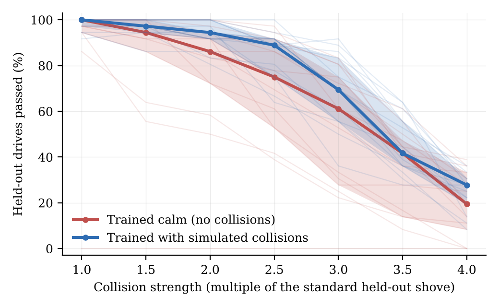

# Does Practising Collisions Help? Neuroevolved driving agents trained with and without simulated collisions

Code, data and paper for the technical report:

> M. D. Rathod. *Does Practising Collisions Help? Robustness and Reliability of Neuroevolved Driving Agents Trained With and Without Simulated Collisions.* Technical report, 2026. [doi:10.5281/zenodo.24406594](https://doi.org/10.5281/zenodo.24406594)

> **Paper version:** the code and results exactly as used in the paper are frozen at tag [`paper-collision-2026`](https://github.com/madhurrathod/neuroevolution-collision-robustness/tree/paper-collision-2026) (also available under Releases). The `main` branch keeps developing the game, so later versions may differ.

**Finding, in one line:** across 30 seeded neuroevolution runs, practising simulated collisions in training did not make the typical driver much more robust (median robustness 184 vs. 181 out of 252), but it made training reliable: every collision-trained run produced a competent driver (worst 160), while calm training produced fragile networks and one run that never learned to drive.



## What is here

| Path | What it is |
|---|---|
| `paper/paper.pdf`, `paper/paper.tex` | The report |
| `experiment.mjs` | Trains one network (seeded, from random weights) under one condition, then runs the held-out test |
| `stress.mjs` | Stress test of a trained network with shoves from 1x to 4x strength |
| `paper/analyze.py` | Statistics and figure (`python3 paper/analyze.py results`) |
| `results/` | All 30 trained networks with learning curves and per-drive test results, and their stress-test results |
| `logs/` | The console output of every run |
| `run_all.sh`, `results/jobs*.txt` | Runs a list of jobs in parallel |
| `ai.js`, `car.js`, `track.js`, ... | The simulator and the neural-network driver (the same code the browser game uses) |
| `index.html`, `main.js`, ... | The browser game itself |

## Reproduce

```sh
npm install                                            # installs three.js
node experiment.mjs --condition shoves --seed 1        # ~6-16 min on one core; writes results/shoves_seed1.json
node stress.mjs results/shoves_seed1.json              # ~10 s
pip install scipy matplotlib && python3 paper/analyze.py results
```

The same seed always gives the same network. The car physics are deterministic; the only randomness is in evolution, and it is seeded.

## Play the game

**Play online:** https://madhurrathod.github.io/neuroevolution-collision-robustness/ (choose the circuit and press **V** to see the AI car's sensor rays).

Or locally: serve the folder (for example `python3 -m http.server 8000`) and open http://localhost:8000/. Choose the circuit and press **V** to see the AI car's sensor rays.

## How this was made

The game, simulator and experiment code were written with Claude (Anthropic), an AI assistant, under the author's direction. The author ran the experiments on his own computer. See the "Use of AI tools" section of the paper.
